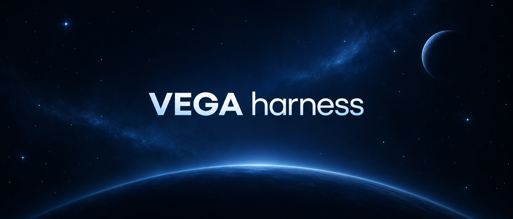

<div align="center">



# From task to result.

### Your project. Your models. An agent that takes action.

Files, terminal, browser, and search — in one working session.

[ `🇷🇺 Русский` ](README.md) ・ **`🇬🇧 English`**

[](LICENSE) [](https://github.com/lingeniare/vegaharness) [](SAFETY.md)

**[Quick start ↓](#run)** · **[Capabilities ↓](#capabilities)** · **[For developers ↓](#developers)**

</div>

---

**VEGA Harness** is an open-source environment for AI agents, built on [DeepSeek Harness](https://github.com/deepseek-ai/deepseek-harness). Give an agent a task and a working directory: it can explore materials, edit files, execute commands, and search the web. Follow its progress, tool calls, and results in one session.

<a id="capabilities"></a>

## One session. From research to finished files.

| | What your task gets |
|---|---|
| 🛠️ **Project tools** | File reading and editing, terminal commands, and test runs. The agent works with the contents of your working directory. |
| 🔎 **Search with sources** | Web search and page retrieval through VEGA. Ask for links, comparisons, and fact checks. |
| 🧠 **Model choice** | VEGA account sign-in and a catalog of models available to your account. Choose a model for the task through the interface. |
| 🛡️ **PII shield** | Optional request anonymization on VEGA's side. Enable it separately; it is off by default. [How it works](packages/llm/llm-vega-account/README.md). |
| ⏰ **Scheduled tasks** | Recurring assignments and scheduled follow-ups. [Capabilities and conditions](packages/schedule/README.md). |
| 🧩 **Extensions** | Connect tools, MCP servers, and skills, including VEGA Studio for image and video generation. Availability depends on installed extensions and their configuration. |

### Start with the task you have been putting off

Example prompts for your selected working directory:

**Code → changes and verification**

> “Explore this project, find the cause of the bug, propose a fix, and run the relevant tests.”

**Sources → an informed decision**

> “Compare three solutions for our project. Find current documentation, include source links, and save your findings in Markdown.”

**Documents → a finished report**

> “Read the materials in this folder and prepare a brief report: key points, open questions, and next steps.”

**Idea → media** · with a configured VEGA Studio skill

> “Create an illustration and a short video for this article. Save the results in the project folder.”

---

<a id="run"></a><a id="run-from-source"></a>

## Your first task

Running from source requires **Node.js ≥ 24.9** and **pnpm**; the pnpm version is pinned in [package.json](package.json). Download this repository and open a terminal in its root:

```sh
pnpm install
pnpm run build
pnpm dsh web
```

1. **Open the Web UI** at the address printed by the command; the default is `http://127.0.0.1:3080`.
2. **Sign in with a VEGA account.** The app obtains a managed API key and loads available models; you do not need to copy a key manually.
3. **Choose a working directory and a model.** Create a session and send your first task.

> **Developer preview.** Breaking changes are possible. Read the [safety notice](SAFETY.md) before running; the active permission policy controls access to files and commands.

---

<a id="developers"></a>

## Build an agent around your workflow

The architecture is **everything is a plugin**, powered by Cordis. Model adapters, tools, session storage, sandboxing, and the agent loop are composed through configuration. Change the agent's components and develop your own extensions.

Sessions preserve work history and tool calls, support resuming after a restart, and compact context. See the [architecture guide](docs/architecture.md) for details.

| I want to… | Start here |
|---|---|
| Learn the interface | [Web UI guide](docs/user/guide/index.md) |
| Connect another provider | [Model configuration](docs/user/guide/providers.md) |
| Create a plugin | [Plugin development](docs/user/develop/basic/index.md) |
| Contribute | [Getting started](CONTRIBUTING.md) · [Development guide](docs/development.md) |

---

<div align="center">

### Have a task, an idea, or feedback?

[](mailto:mail@vega.chat) [](https://t.me/ingeniare) [](https://vega.codes)

<sub>License: <a href="LICENSE">MIT</a> · Built on <a href="https://github.com/deepseek-ai/deepseek-harness">DeepSeek Harness</a> · Powered by <a href="https://getmya.io">getmya.io</a></sub>

</div>
